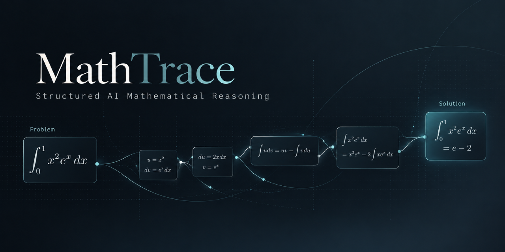

# MathTrace



**MathTrace** is an AI-powered mathematical problem-solving workflow and formal verification runtime. It combines autonomous multi-agent mathematical reasoning with rigorous, tamper-evident audit trails, native execution with optional Linux sandboxes, and interactive Lean 4 proof checking.

MathTrace structures mathematical inquiry into an immutable, ledger-backed process—ensuring that every theorem, proof obligation, computational step, and counterexample is tracked, verified, and preserved with complete provenance.

---

## Key Capabilities

- **Immutable Transactional Ledger**: All mathematical claims, assumptions, inferences, and campaign events are recorded in an append-only SQLite store with cryptographic SHA-256 state digests.
- **Scoped Evaluation & Cycle Detection**: Inferences are evaluated within strict local scopes using conservative antitone bounds and selected witness forests (`scoped-selected-forest-v3`), preventing circular logic and premature global assertions.
- **Nonparty Adjudication & Challenge Resolution**: Formal objections, refutations, and counterarguments are adjudicated independently by nonparty review protocols, preventing silent substitution of historical audit witnesses.
- **Formal Proof Verification**: Proof code is verified using a pinned official Lean 4 toolchain and checked-target primitive-context replay. Native execution is the default; Linux Bubblewrap is optional. Standalone fresh checks retain `leanchecker --fresh`.
- **Adaptive Frontier Coordination**: Campaigns dynamically project active problem frontiers, track multi-step obligation lineage, and manage committed work intents with crash-resilient, idempotent recovery.
- **Advisory Learning Layer**: Heuristics, proof tactics, and empirical research patterns are curated against verified event lineage to advise reasoning agents without contaminating deductive proof graphs.
- **Native Multi-Agent Roles**: Specialist agent roles (strategists, provers, falsifiers, adjudicators, and formalizers) operate under tool-free, isolated boundaries with attributable terminal transcript recording.

---

## Repository Structure

```text
MathTrace/
├── mathtrace/             # Core Python runtime, CLI, and Lean semantic inspector
├── tests/                 # Comprehensive regression test suite
├── tools/                 # Developer setup, package validation, and native installers
├── docs/                  # Operational guides, workspace map, and architectural decisions
│   ├── README.md          # Detailed repository navigation guide
│   ├── architecture/      # Authoritative architectural records and review dispositions
│   ├── coordination.md    # Adaptive frontier and obligation tracking
│   ├── evaluation.md      # Scoped support, refutations, and witness forests
│   ├── evidence.md        # Computational receipts and formal checking boundaries
│   ├── execution.md       # Durable intent, sandbox isolation, and recovery
│   ├── native-capture.md  # Terminal observation and host attribution limits
│   ├── completion.md      # Criteria fulfillment and stopping criteria
│   └── learning.md        # Advisory extraction, curation, and target admission
├── openspec/              # OpenSpec specifications, changes, and configuration
├── coding-harnesses/      # Agent harness definitions for supported environments
└── work/                  # Local validation runs, toolchains, and recovery archives (not committed)
```

---

## Requirements and Prerequisites

- **Python**: Version 3.11 or newer.
- **Operating System**: Windows, Linux or macOS. Native execution requires no WSL or container.
- **Optional Execution Sandbox**: Select `execution_mode: "bubblewrap"` explicitly to use Linux Bubblewrap and `libseccomp`, including the existing Windows/Ubuntu WSL transport.
- **Interactive Theorem Prover**: Pinned Lean v4.30.0 toolchain (provisioned by the `install_lean` runtime operation).

---

## Getting Started

### 1. Installation

A project-local npm installer is available for **local package validation**; registry
publication is not part of this checkout. See [installation](docs/installation.md)
for artifact assembly, Python prerequisites, host setup and safe updates. The
intended distribution command is `npx mathtrace@latest`; current artifacts remain
private and must not be published without the owner's separate authorization.

Install MathTrace in development mode or as a standalone wheel:

```bash
# Clone or navigate to the repository
cd MathTrace

# Install Python package in editable mode
pip install -e .
```

Only when choosing optional Bubblewrap execution, provision its Linux or WSL environment:

```bash
python tools/setup_execution.py
```

### 2. Command-Line Interface

The MathTrace CLI provides a unified control surface for campaign administration:

```bash
# Display CLI identity and available commands
python -m mathtrace identity
python -m mathtrace --help

# Initialize a new mathematical campaign database
python -m mathtrace init --db .math/state.sqlite

# Check campaign database health and state digest
python -m mathtrace health --db .math/state.sqlite

# Export a state snapshot
python -m mathtrace snapshot --db .math/state.sqlite
```

#### Registering a Mathematical Contract

Create a JSON contract definition (e.g., `contract.json`):

```json
{
  "statement": "For every positive real x, x squared is positive.",
  "definitions": [],
  "completion": "An exact proof or a domain-valid counterexample."
}
```

Register the contract into the campaign ledger:

```bash
python -m mathtrace contract --db .math/state.sqlite --input contract.json
```

The CLI returns an immutable contract identifier used for downstream claim registration, inference submission, and candidate auditing.

### 3. Interactive Agent Workflows

MathTrace equips AI agents and human researchers with specialized skills:

- **`/mathtrace-help`**: Interactive discovery guide explaining workflows, specialist roles, and research phases.
- **`/math-intake`**: Formalizes problem statements, definitions, and completion contracts.
- **`/math-research`**: Explores lemmas, candidate proof branches, and computational experiments.
- **`/math-formalize`**: Translates informal arguments into verified Lean 4 declarations.
- **`/math-audit`**: Runs multi-dimensional audits on frozen solution candidates.
- **`/math-release`**: Finalizes audited solutions and issues release receipts.

To update or synchronize the local agent environment in `.agents/`:

```bash
python tools/install_native.py
```

---

## Verification and Testing

MathTrace includes a comprehensive test suite covering database transactions, cycle detection, witness forest memoization, Lean checking integration, and host capture isolation:

```bash
# Run full deterministic test suite
pytest tests

# Build and validate isolated package wheel
python tools/validate_package.py

# Validate OpenSpec specifications and changes
openspec validate --all
```

---

## Development and Specifications

Project maintenance and feature development are governed strictly through **OpenSpec**. System requirements and verified capability behaviors are documented under:

```text
openspec/specs/
```

Before proposing changes, review the coding agent instructions in [AGENTS.md](AGENTS.md) and the operational guides in [docs/](docs/).

---

## Copyright and Licensing

Copyright © 2026 Velor-dev. Public project author/developer: [Velor-dev](https://github.com/Velor-dev).

MathTrace is proprietary and source-available, with free personal, academic,
and commercial use under [LICENSE](LICENSE). The license permits installation
and necessary project-local/internal operational copies, while reserving general
modification and redistribution rights. See the third-party attribution below.

When publishing your own project, exclude installed MathTrace software assets
(including its runtime, skills, agents, and copied guides) and direct users to
install the official distribution. Your original research, proofs, results, and
project files are not restricted merely because you used MathTrace. Do not
remove your own shared instruction files; exclude only copied MathTrace material
from public redistribution. These permissions do not override third-party terms.

The npm package remains private and publication safeguards remain enabled.
GitHub source publication does not publish the npm package or create a release.

## Third-party attribution

SOURCE REPOSITORY ONLY: OpenSpec development skills
The retained .agents/skills/openspec-* skill frontmatter identifies OpenSpec
1.14.3, MIT. Upstream: https://github.com/Fission-AI/OpenSpec/tree/v1.14.3
License source: https://github.com/Fission-AI/OpenSpec/blob/v1.14.3/LICENSE
These development skills are excluded from the runtime wheel/npm payload.
Their applicable upstream license follows; inclusion of this notice in an
artifact does not mean those skills are bundled there.

MIT License

Copyright (c) 2024 OpenSpec Contributors

Permission is hereby granted, free of charge, to any person obtaining a copy
of this software and associated documentation files (the "Software"), to deal
in the Software without restriction, including without limitation the rights
to use, copy, modify, merge, publish, distribute, sublicense, and/or sell
copies of the Software, and to permit persons to whom the Software is
furnished to do so, subject to the following conditions:

The above copyright notice and this permission notice shall be included in all
copies or substantial portions of the Software.

THE SOFTWARE IS PROVIDED "AS IS", WITHOUT WARRANTY OF ANY KIND, EXPRESS OR
IMPLIED, INCLUDING BUT NOT LIMITED TO THE WARRANTIES OF MERCHANTABILITY,
FITNESS FOR A PARTICULAR PURPOSE AND NONINFRINGEMENT. IN NO EVENT SHALL THE
AUTHORS OR COPYRIGHT HOLDERS BE LIABLE FOR ANY CLAIM, DAMAGES OR OTHER
LIABILITY, WHETHER IN AN ACTION OF CONTRACT, TORT OR OTHERWISE, ARISING FROM,
OUT OF OR IN CONNECTION WITH THE SOFTWARE OR THE USE OR OTHER DEALINGS IN THE
SOFTWARE.


DOWNLOADED SEPARATELY: Lean toolchain
The installer downloads the pinned official Lean distribution; it is not
bundled in the MathTrace wheel/npm archive. Lean is Apache-2.0 licensed.
https://github.com/leanprover/lean4/blob/v4.30.0/LICENSE
Official archives also contain LICENSES for bundled third-party components;
retain and consult those complete files in the downloaded toolchain. This
summary does not replace their terms.

EXTERNAL PREREQUISITES, NOT BUNDLED
Python, Node.js, coding harness applications, and Pi's upstream subagent
extension are separately installed and retain their own terms. Harness names
identify compatibility, not MathTrace ownership of those applications.
Optional Bubblewrap (LGPL-2.1) and libseccomp are separately provisioned;
consult their own installed notices. They are not required by Direct Execution.
https://github.com/containers/bubblewrap/blob/main/COPYING

The MathTrace runtime has no declared third-party Python dependencies and the
npm installer has no production npm dependencies. Build tooling is external.
