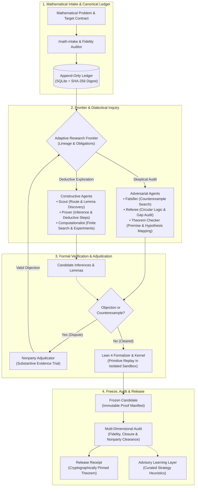

# Design: Architecture and Workflow Flowchart

## Context

MathTrace operates a multi-agent mathematical reasoning and verification architecture described across multiple operational documents (`docs/coordination.md`, `docs/evaluation.md`, `docs/evidence.md`). To maximize accessibility and communication effectiveness in [README.md](../../README.md), the system workflow should be presented visually using GitHub's native Mermaid.js renderer.

See [proposal.md](proposal.md) for motivation and high-level requirements.

## Goals / Non-Goals

**Goals:**
- Provide a clear, psychologically intuitive visual model of MathTrace's workflow.
- Illustrate the dialectical balance between constructive proof discovery and adversarial falsification.
- Highlight the central role of the append-only ledger, the Lean 4 formal verification engine, and nonparty adjudication.
- Render reliably and responsively in GitHub Flavored Markdown (supporting both light and dark themes).
- Keep all terminology and annotations strictly in English.

**Non-Goals:**
- Generating raster/vector image files (PNG/SVG) that require external asset hosting or binary tracking.
- Representing every internal Python function or CLI flag; the diagram models architectural workflow, not code execution callstacks.

## Decisions

### 1. Orientation: Top-to-Bottom (`flowchart TD`)
- **Rationale**: GitHub pages scroll vertically. A top-to-bottom flow naturally aligns with user reading patterns, allowing subgraphs to group related functions into clear chronological phases while keeping node widths responsive on both desktop and mobile views.
- **Alternatives Considered**: Left-to-Right (`flowchart LR`) was considered, but complex subgraphs with dual-track feedback loops become overly wide and trigger horizontal scrollbars on GitHub.

### 2. Dual-Track Subgraph for Dialectical Research
- **Rationale**: Psychologically, placing the Constructive Track (`Scout`, `Prover`, `Computationalist`) alongside the Adversarial Track (`Falsifier`, `Referee`, `Theorem Checker`) communicates that MathTrace does not take claims at face value. The adversarial tension and feedback loop into the `Nonparty Adjudicator` visually demonstrates zero tolerance for circular reasoning or unsubstantiated conjectures.
- **Alternatives Considered**: A single linear chain of agents; rejected because it misrepresents the parallel and adversarial nature of MathTrace's multi-agent system.

### 3. Native Styling and Visual Polish
- **Rationale**: Using clean pastel/tinted fills with distinct semantic borders:
  - Ledger / Foundation: Warm amber/gold tint (representing immutable persistence).
  - Constructive Path: Cool cyan/emerald tint (representing progress and derivation).
  - Adversarial & Challenge Path: Soft crimson/coral tint (representing skepticism, boundary testing, and falsification).
  - Formal Verification: Deep violet/indigo tint (representing Lean 4 mathematical proof checking).
  - Release & Advisory: Emerald/green tint (representing verified success and certified delivery).
- **Alternatives Considered**: Unstyled default Mermaid boxes; rejected because plain gray boxes make it harder for the human eye to quickly segment functional domains.

### 4. Diagram Structure and Node Hierarchy

## Risks / Trade-offs

- **[Risk] GitHub Mermaid Version Incompatibilities** → Use standard flowchart syntax (`flowchart TD`, standard subgraphs, clean classDef definitions) rather than experimental features to ensure robust rendering on web and mobile GitHub clients.
- **[Risk] Visual Overload** → Keep agent descriptions grouped into cohesive functional nodes rather than separate floating boxes, maintaining readability and cognitive ease.
